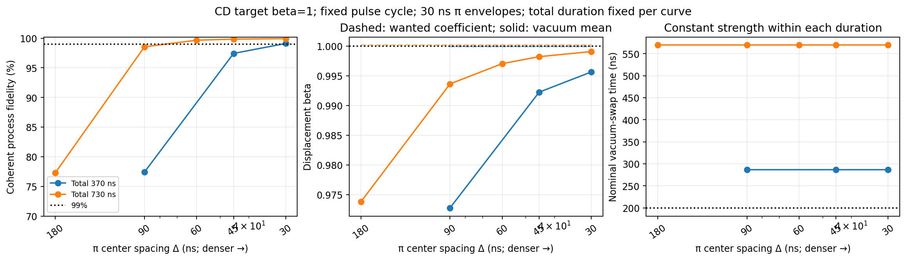
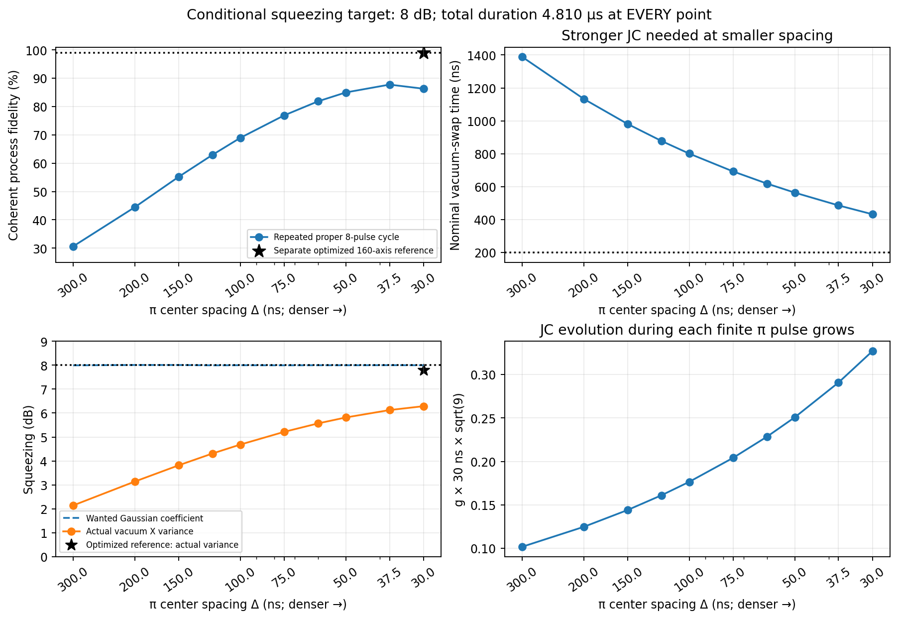
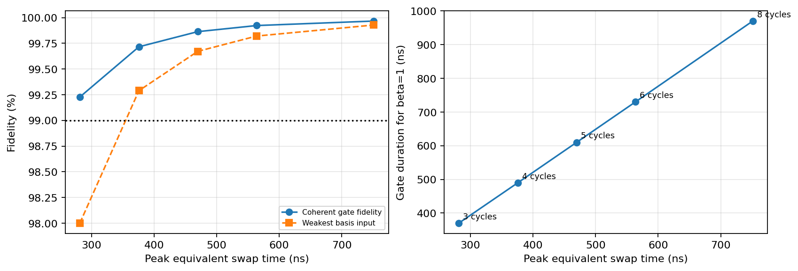

# Conditional displacement and squeezing with a constant sideband

Open the populated notebooks:

- [Fast conditional displacement](notebooks/fast_conditional_displacement.ipynb): pulse sequence, same-beta strength comparison, signed-beta scaling, cancellation analysis and fresh full-input replay.
- [Conditional squeezing](notebooks/conditional_gaussian_gates.ipynb): 8 dB target, complete pulse recipe, tested cancellation mechanisms, photon-dependent errors and fresh boundary-input replay.
- [Single-mode squeezing](notebooks/single_mode_squeezing.ipynb) (2026-11-20): vacuum to 8 dB with the qubit starting and ending in g.
  - The conditional squeeze on |g> gives 0.9989 in 4.81 us, from verified columns.
  - The Singh/Royer/Girvin GCR gadget with ideal CDs gives 0.9971 in 4.42 us.
  - The same gadget with the real 130 ns CDs, replayed at pulse level, gives 0.9974 in 5.46 us, after 21 gadgets on a fixed schedule.
  - Setting each step from the state's measured <x^2> stalls near 4 dB.

Python and C++ sources live in [code/](code/). Current notebooks live in
[notebooks/](notebooks/), historical notebooks in
[notebooks/archive/](notebooks/archive/), and simulations in [runs/](runs/).
The two primary notebooks contain **15 executed code cells and 13 embedded
figures**, with no HTML required. The research discussion and challenges are
in [WORK_STATUS.md](WORK_STATUS.md).

Current priority is gate speed and pulse-spacing dependence. The historical
[phase-refinement study](notebooks/phase_controlled_cd.ipynb) is retained for
its derivations; its small same-duration fidelity gains are not a current
recommendation and are not being optimized further.

## New fastest CD with the 2026-11-20 sideband freedoms (310 ns)

The user now allows 10 ns constant-radius sideband phase arcs at any time,
or 30 ns down-up dips. With these, a certified CD β=1 takes **310 ns at
99.3064 %** process fidelity on all 18 inputs. The vacuum inputs give
99.914 % (g0) and 99.932 % (e0).

- **Pulses:** ten identical 30 ns π pulses with one phase each.
- **Sideband:** constant scale, g = 7.779 rad/µs. The filtered peak corresponds
  to a 200.6 ns swap.
- **Phase moves:** 29 contiguous 10 ns arcs, each turning by at most π. The
  filtered plateau ripple is ±0.04 %.
- **Frame:** one declared final qubit Rz.
- **Verification:** cutoff converged at 96 levels, independent order-16 check,
  SDK compile.
- **Limitation:** it is a compiled 41-parameter table, not a few-parameter
  block.

The same freedoms give β=2 in 850 ns (99.10 %, certified). The rule below needs
1090 ns. Repeating the 310 ns gate twice gives β=2 from vacuum at 99.67 %.

The bound β ≤ ½∫|g|dt holds for any qubit control or sideband phase. It
forbids 8 π pulses (250 ns), and 280 ns with waits reaches only 95.2 %. No
squeeze shorter than 4.81 µs reached 99 %.

Details, the table and failures:
[runs/new_freedoms_2026_11_20/README.md](runs/new_freedoms_2026_11_20/README.md).

## Pulse spacing: same target, same total duration

The new plots decrease the center spacing by using more complete pulse cycles
inside the SAME time window. Every physical pi envelope remains 30 ns.
CD targets beta=1 at fixed totals of 370 ns and 730 ns. Conditional squeezing
targets 8 dB at a fixed total of 4.810 us. Pulse axes and coupling are not
optimized for fidelity. Squeezing retains its one declared final qubit Z frame,
common to all 18 inputs. One constant sideband coupling normalizes the
wanted first/second Magnus coefficient of the actual SDK/RFDC waveform; the
coefficient agrees with the target within 0.3%, limited by DAC rounding.



At 370 ns, spacings of 90 / 45 / 30 ns give CD process fidelities of
77.4136% / 97.4220% / 99.1035%. At 730 ns, 30 ns spacing gives 99.9149%.
The coupling remains constant within each CD duration group. The target
normalization differs slightly from the separately calibrated reference below.



The repeated squeezing cycle is Y,X,Y,X,-Y,-X,-Y,-X, a proper first-average-zero
second-order squeezing construction. Its process fidelity improves from 30.64%
at 300 ns spacing to 87.74% at 37.5 ns, then gives 86.29% at 30 ns. Smaller
spacing requires stronger JC to retain 8 dB in the same time. Finite 30 ns
pulses therefore do not vanish in this sweep, and the last point need not
improve. The plot also shows nominal generator strength and achieved vacuum
squeezing separately. Errors are not hidden by redefining the target.

The separate optimized 160-axis reference is marked as a star, not joined to
the eight-pulse-cycle curve. Its 99.0183% at the same 4.810 us and 30 ns spacing
uses a different qubit phase pattern. The [data](runs/pulse_spacing/summary.json)
contain 18 points, 324 input columns and 133,632 independent complex-amplitude
comparisons. Every point has independently converged target/output cutoffs.

## Currently verified fixed-sideband gates

| Gate | Envelope duration | Coherent process fidelity | Weakest basis input | Peak equivalent swap |
|---|---:|---:|---:|---:|
| CD beta=1 | 370 ns | 99.2278% | 97.9996% | 281.33 ns |
| Conditional squeezing, 8 dB | 4810 ns | 99.0183% | 95.9283% | 351.57 ns |

Both gates keep sideband phase and plateau amplitude constant, with only
5 ns amplitude ramps at the beginning and end. Every physical qubit pulse
uses a 30 ns envelope. Peak coupling, including the modeled digital-filter
overshoot, obeys

$$|g(t)|\leq\frac{\pi}{2(0.200\,\mu\mathrm{s})}
=7.85398\;\mathrm{rad}/\mu\mathrm{s}.$$

The model has a perfect two-level qubit, resonant JC and no dissipation or
static dispersive term. The qubit drive is assumed calibrated at the chosen
steady pump-on frequency. Unknown device-dependent detuning during the two
outer ramps and analog transfer functions beyond the stated RFDC model are
not inferred. These are verified ideal-model fidelities, not measured device
fidelities or a proof of globally shortest gates.

Duration is the programmed device-envelope span. Both channels share the same
time origin; common buffer/DAC latency is not charged. Simulations propagate
the complete interpolator tail. IQ figures align the common filter delay for
readability without deleting any propagated samples.

## The actual targets and fidelity

With sigma_z=+1 on g and -1 on e, the targets are

$$U_{\mathrm{CD}}(\beta)=
\exp[\beta\sigma_x(a^\dagger-a)],$$

$$S_z(r)=\exp\!\left[\frac r2\sigma_z(a^2-a^{\dagger2})\right],
\qquad r=\frac{8\ln10}{20}=0.921034.$$

Thus CD beta=1 displaces the sigma_x branches by +1 and -1; their separation
is 2. A change of qubit basis converts conditional sigma_x displacement to
sigma_z displacement. Such additional physical basis rotations take their
own pulse time and are not silently included in the quoted CD duration.

The input subspace comprises all **18 inputs**, qubit g/e times Fock n=0..8.
For exact target output columns T and simulated output columns V,

$$F_{\mathrm{proc}}=
\frac{|\operatorname{Tr}(T^\dagger V)|^2}{18^2}.$$

Relative phases and leakage count. This coherent process score differs from
an average of 18 basis-state fidelities. It also does not guarantee 99% on
every individual input; the weakest basis values are reported in the table.
The target and output are propagated at increasing oscillator cutoffs until
both converge. They are never projected back and renormalized to n<=8.

## Literal CD sequence and scaling

At beta=1, play twelve full pi pulses with DAC axes

```text
Sideband: 5 ns ramp up | constant phase 270 deg and amplitude | 5 ns ramp down
Qubit:               | X X -X -X | X X -X -X | X X -X -X |
Each qubit pulse: 30 ns; no gaps; total programmed duration: 370 ns.
```

Use nominal vacuum swap 283.207905 ns. No final qubit Z frame is needed.
The [12-pulse table](runs/research_verified/cd_constant_reference_pulses.csv)
and [SDK int16 words](runs/research_verified/cd_constant_reference_words.npz)
give the literal controls. X and -X have DAC phases 0 and 180 degrees.

For general signed beta, let b=|beta| and use this checked empirical rule:

$$K=\left\lceil\max(2.5b,2.25b^2)\right\rceil,\qquad
L=(0.120K+0.005)\;\mu\mathrm{s},$$

$$g_0=\frac{2b}{L},\qquad g=g_0(1+c g_0^2),\qquad
c=0.0004071933463\;\mu\mathrm{s}^2,$$

$$t_{\mathrm{swap}}=\frac{\pi}{2g},\qquad
T=(0.120K+0.010)\;\mu\mathrm{s}.$$

Repeat X,X,-X,-X exactly K times; keep this one constant g throughout.
Positive beta uses pump phase 270 degrees and negative beta adds 180 degrees.
The single correction coefficient comes from beta=1, rather than fitting
phases separately at every beta. All 20 listed signed test points, from
|beta|=0.05 to 4, exceed 99% process fidelity; their minimum is 99.1038%.
Their independent checks cover 360 input columns and 71,424 complex
amplitudes. The [scaling data](runs/constant_pump_gaussian/binary_rule_summary.json)
and current CD notebook list every tested point. This empirical rule does not
guarantee untested interpolations or extrapolations. Beta=0 uses no gate.

## Compare the same target when changing sideband strength

Each row below targets beta=1. Weaker coupling gets a longer gate. Only one
constant g is calibrated for each cycle count; qubit phases stay unchanged.

| Constant-sideband cycles | Duration for beta=1 | Nominal swap | Coherent process fidelity |
|---:|---:|---:|---:|
| 3 | 370 ns | 283.18 ns | 99.2277% |
| 4 | 490 ns | 378.24 ns | 99.7167% |
| 5 | 610 ns | 472.95 ns | 99.8641% |
| 6 | 730 ns | 567.64 ns | 99.9234% |
| 8 | 970 ns | 756.40 ns | 99.9673% |



The small difference between the first curve point and the reference table
comes from independent scalar calibration and SDK quantization. Increasing
swap time while freezing duration would under-displace; that is not a
Trotter-error comparison and is excluded from these plots.

## Conditional squeezing sequence and optimization

Play the [complete 160-pulse axis table](runs/research_verified/squeeze_constant_reference_pulses.csv)
with one 30 ns pi envelope per row and no gaps. Keep the sideband plateau at
phase 0 degrees and nominal swap 353.947368 ns, with 5 ns outer ramps.
Apply one final tracked qubit rotation

$$R_z(\varphi)=e^{-i\varphi\sigma_z/2},\qquad
\varphi=-3.331687648435443\;\mathrm{rad}.$$

That declared frame is included in the coherent score. The
[exact packed words](runs/research_verified/squeeze_constant_reference_words.npz)
and [certificate](runs/research_verified/squeeze_constant_reference.json)
remove ambiguity about every axis, sample and frame.

The reference optimizer adjusts physical qubit axes at fixed pump, pulse
length and rotation angle. It uses analytic-gradient L-BFGS and the coherent
18-column objective, with one final qubit Z frame. The saved 160-pulse run
starts from a neighboring longer-gate solution: 1,750 objective evaluations
raise its design-model score from 80.2378% to 99.0163%. Subsequent SDK/RFDC
replay and cutoff convergence give the reported 99.0183%. It is a local
compiled solution; we do not claim its 160 phases are a simple fourth-order
product formula. Short-block Magnus calculations guide the separate
structured alternatives described in the notebook.

## What the strategic tests established

- **CD:** the four-pulse word cancels finite-pulse transverse terms. Instantaneous X and -X toggle JC identically, so its improvement is not a claim of higher instantaneous Trotter order. An independently derived cubic functional has one sign for X-only paths. Mixed axes are needed to reverse that particular coefficient; timing alone can reduce it. The best independently replayed shorter candidates give 98.2371% at 315 ns and 97.4377% at 330 ns, and are rejected.
- **Squeezing:** enumerating 65,536 eight-pulse words gives 680 closed zero-first-average paths and 16 pure second-order squeezing blocks. Their tested positive combinations share a photon-dependent fourth-order error, so scalar strength calibration cannot correct every n. Finite bridge pulses, composite pi/N paths and phase cycles were included rather than treated as free ideal rotations.
- **Optional pump phase changes:** only constant-radius 10 ns IQ arcs were considered in the new branch. Opposite-chirality pairing cancels the added second-order conditional-number term, but the faster full gates still miss 99%. A checked construction reaches 99.19% only at 15.695 us. It does not improve on the fixed-sideband reference and has small filtered magnitude ripple.
- **Bridge-free qubit-Z endpoint:** a meet-in-the-middle search covers all eight- and ten-pulse words over ±X/±Y pi and pi/2 envelopes. None of the 855,296 / 50,039,808 paths ending at Z has zero first JC average. This rules out that discrete symmetry construction before a long gate fit; it does not rule out other fractions or timings. The first moments independently match 4,096 full oscillator/qubit Cauchy coefficient amplitudes across 32 test paths. [Search results](runs/open_z_squeezing/length10.json).

The [CD research report](runs/strategic_cd/README.md),
[squeezing research status](runs/strategic_squeezing/STATUS.md), and
[independent review](runs/independent_review/REVIEW.md) distinguish derivations,
screens and independently checked full gates. None of the new structured
families has yet produced a faster accepted gate. Low-order cancellation is
a design argument; the full quantum propagation decides fidelity.

A complete-waveform quantum derivative check also corrects an earlier
isolated-block inference: the original 370 ns gate **already cancels its
second Magnus term**, to a norm of 5.44e-16 after factoring out g squared.
Its unwanted first-order ramp term and cubic/higher errors survive. The new
phase-refined gate's fidelity gain is not evidence that its entire cubic
generator has been cancelled; the notebook explicitly compares those terms.

JC phase changes use 10 ns quintic arcs on a constant programmed radius,
centered on qubit-envelope zeros. The complete SDK/RFDC waveform is propagated,
including its small magnitude ripple. Four new certificates compare 72 input
columns and 13,824 complex amplitudes. Discrete winding, signed-plateau,
compensated-Y and pulse-pair-removal families all failed to produce a shorter
99% gate in this finite study.

## Verification and reproduction

The current two references were independently checked on 36 input columns
and 14,976 complex amplitudes. Cutoffs converge at 96 oscillator levels for CD
and 320 for squeezing; the squeezing target itself requires the larger space.
The current notebooks additionally replay CD at 128 levels and squeezing g8/e8
at 384. The five fixed-beta comparison gates add 90 input columns and 11,520
independent amplitude comparisons. Counts are asserted, rather than inferred
from a final PASS line.

Forward simulation decodes SDK int16 words, applies the documented RFDC 8x
interpolator, and includes simultaneous JC/qubit dynamics and the full filter
tail. A separate order-16 propagator compares complex output amplitudes.
The unchanged SDK compiles two merged waveform plays with one common trigger.
No board experiment, runtime, calibration, NCO or SDK code was changed.

From this directory, using the supplied environment:

```bash
export OPENBLAS_NUM_THREADS=1 OMP_NUM_THREADS=1
../../acadia_env/bin/python code/verify_research.py --references
../../acadia_env/bin/python code/reference_strengths.py
../../acadia_env/bin/python code/build_research_notebooks.py
PATH="../../acadia_env/bin:$PATH" ../../acadia_env/bin/python code/execute_notebooks.py
../../acadia_env/bin/python code/build_readme.py
../../acadia_env/bin/python code/check_markdown_math.py
../../acadia_env/bin/python code/audit_current_research.py
```

Earlier 300 ns CD / 3.61 us squeezing results varied sideband magnitude and
are retained only in the [historical notebooks](notebooks/archive/). The old
260 ns CD also exceeded the present coupling limit. They are excluded from
the current recommendations and speed comparisons. Dispersive rotation and
coupler modeling are historical appendices rather than current priorities.
